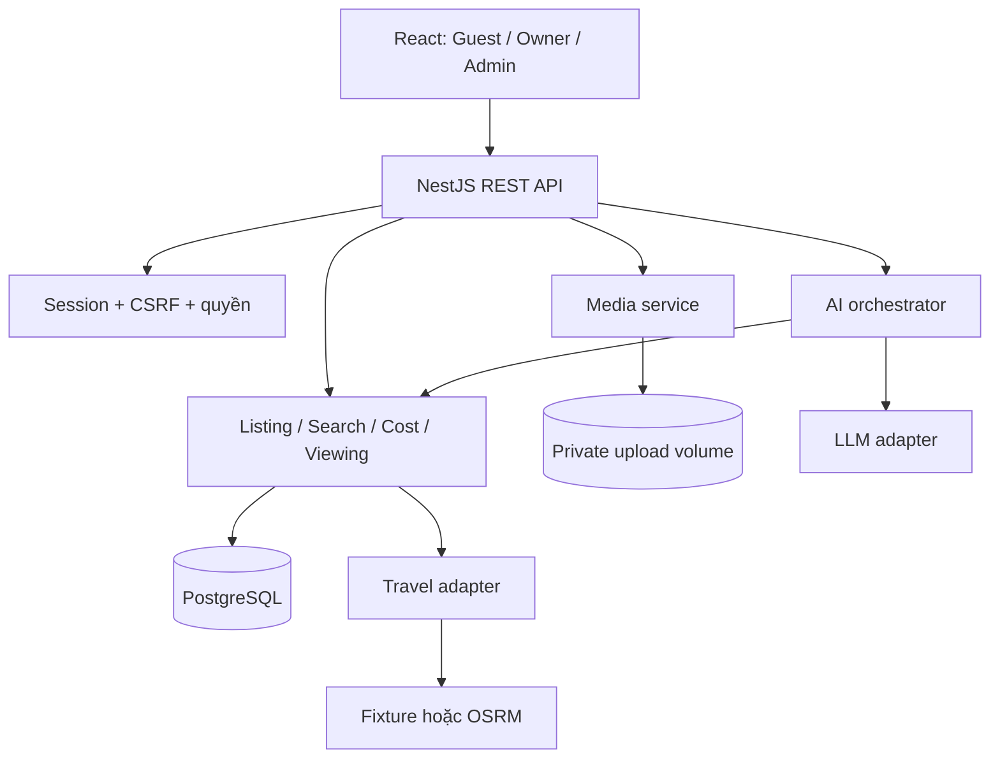
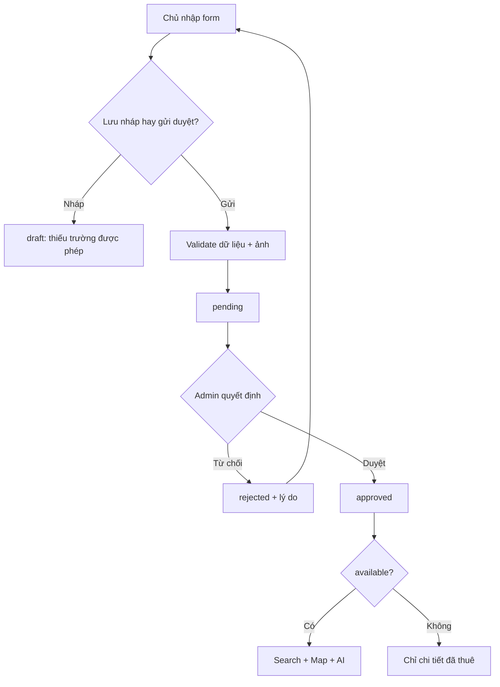
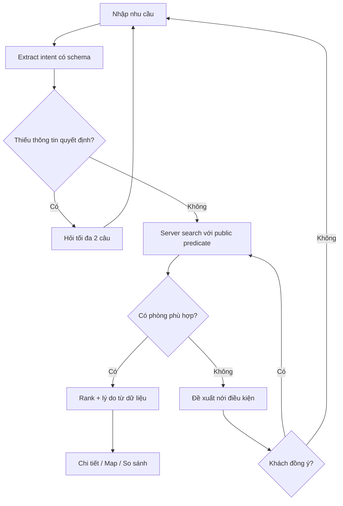
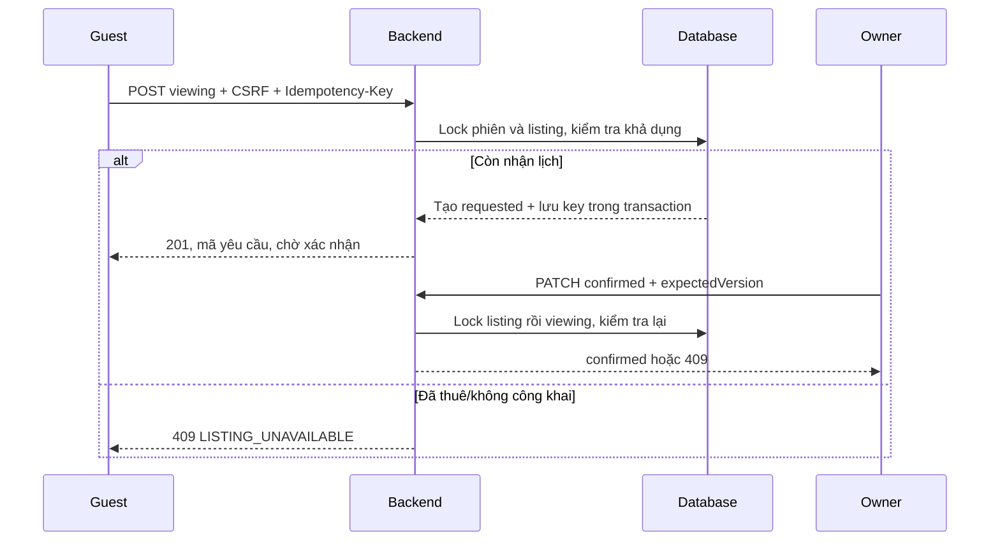

# 01 — Kiến trúc và luồng hệ thống

## 1.1. Kiến trúc

Browser dùng cookie cùng origin; reverse proxy chuyển /api/* vào API và các route khác về SPA. Map tiles được browser tải theo cấu hình provider; API keys có quyền server không đi vào FE.

## 1.2. Phân chia thư mục

| Thư mục | Trách nhiệm |
|---|---|
| apps/web/src/app | router, providers, layouts, error boundaries |
| apps/web/src/features/auth | M02 |
| apps/web/src/features/owner | M03 dashboard, tin, form, profile |
| apps/web/src/features/admin | M04 |
| apps/web/src/features/search | M05 |
| apps/web/src/features/listing-detail | M06 |
| apps/web/src/features/map | M07 |
| apps/web/src/features/assistant | M08 |
| apps/web/src/features/compare | M09 |
| apps/web/src/features/viewings | M10 |
| apps/web/src/shared | UI, formatters, API client, query keys |
| apps/api/src/modules/* | Nest modules tương ứng nghiệp vụ |
| apps/api/src/common | guards, validation, exception filter, logging |
| apps/api/prisma | schema, migrations, seed |
| packages/contracts | OpenAPI + types/client được generate |
| packages/domain | hàm pure tính phí, enum, transition rule không phụ thuộc React/Nest/Prisma |
| infra | compose, reverse proxy, cấu hình môi trường |
| tests/e2e | hành trình xuyên module |

Không gọi API trực tiếp từ mọi component; qua feature service/query hook. Controller BE không chứa công thức phí hoặc query raw tùy tiện; gọi domain service.

## 1.3. Luồng đăng tin và duyệt

## 1.4. Luồng guest và AI

## 1.5. Luồng yêu cầu xem

## 1.6. Phụ thuộc module

M01+M02 là nền. M03 tạo nguồn dữ liệu; M04 quyết định công khai. M05/M06 dùng chung ListingPolicy và CostService. M07, M08, M09 sử dụng SearchService/CostService hiện có. M10 dùng ListingPolicy và chủ sở hữu từ DB.

Không tạo một bản sao room list riêng cho AI/map. Không dùng dữ liệu từ browser để quyết định quyền hoặc duyệt tin.

## 1.7. Ranh giới sync/async

- Transaction chỉ gồm DB và quyết định nghiệp vụ ngắn.
- Upload decode/write, gọi LLM, gọi routing thực hiện ngoài transaction.
- Sau LLM/routing, đọc lại điều kiện public trước trả recommendations.
- Không cần queue/Redis cho baseline một API instance; thêm khi có workload tương ứng.
- Không dùng WebSocket trong demo. Query refetch sau mutation, khi focus và polling lịch 30 giây lúc tab đang mở.
