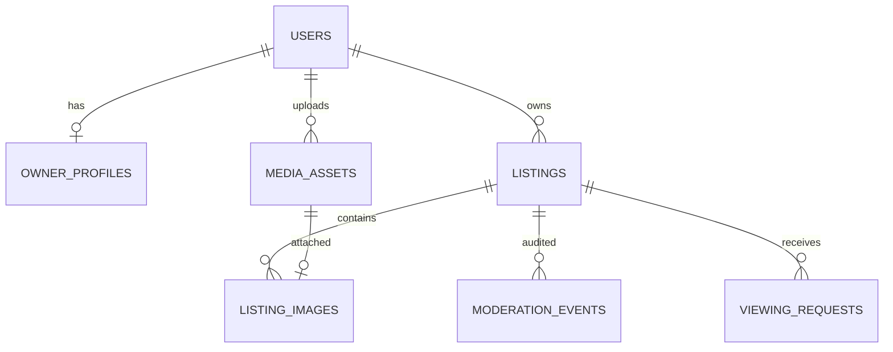
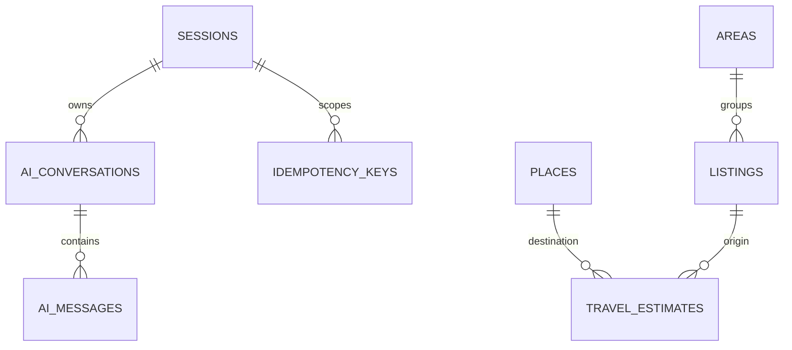

# 03 — Database và nhất quán

contracts/schema.sql là DDL tham chiếu PostgreSQL. Prisma schema/migration khi triển khai phải giữ tương đương enum, FK, index, check và partial unique index. Không chạy DDL rồi chạy migration tạo cùng bảng lần nữa.

## 3.1. Bảng và vai trò

| Bảng | Khóa / cột quan trọng | Ý nghĩa |
|---|---|---|
| users | id, email UNIQUE, password_hash, role, display_name, created_at | Chỉ owner/admin |
| owner_profiles | user_id PK/FK, public_phone, bio, version | Public contact và hồ sơ chủ |
| sessions | id, token_hash UNIQUE, user_id nullable, csrf_hash, expires_at | Phiên guest hoặc đăng nhập |
| areas | code PK, name, active | Nhóm khu vực dùng trong filter |
| amenities | code PK, label | 7 tiện nghi của demo |
| places | id, name, search_text, area_code, lat/lng | POI seed, không nhận URL geocode tự do |
| listings | id, owner_id, moderation_status, availability, version, trường nội dung/phí | Nguồn phòng duy nhất |
| media_assets | id, owner_id, storage_key, mime, width/height, size_bytes | Ảnh private đã xử lý |
| listing_images | listing_id, asset_id UNIQUE, sort_order | Ảnh thuộc một tin; sort 0 là cover |
| moderation_events | id, listing_id, actor_id, action, from/to, reason, listing_version | Audit thay đổi/duyệt/trạng thái |
| viewing_requests | id, receipt_code, listing_id, guest info, preferred_at, status, version | Yêu cầu xem |
| idempotency_keys | session_id, route, key UNIQUE, request_hash, response_json, expires_at | Tránh tạo lịch trùng do retry |
| ai_conversations | id, session_id, filters_json, pending_proposals_json, version | Context AI phía server |
| ai_messages | id, conversation_id, turn_id, role, text, response_json, created_at | Lịch sử + replay turn |
| travel_estimates | listing_id, place_id, mode, source, duration_seconds, distance_meters, expires_at | Fixture/cache routing |

## 3.2. Quan hệ

## 3.3. Mapping trường

API rentVnd→listings.rent_vnd; imageIds→listing_images ordered; amenities→listings.amenities JSONB.
Các giá trị fee JSON output là number sau kiểm tra safe integer, không serialize Prisma BigInt trực tiếp.
Moderation reason hiện tại ở listings.moderation_reason; toàn bộ lịch sử ở moderation_events.
AvailabilityUpdatedAt có thể null với draft chưa từng xác nhận; submit lần đầu nếu null gán now do owner thực hiện. Admin không thay thời điểm này.
User name không dùng làm identity; ownerId luôn FK users.id. OwnerProfile.user_id phải là user role owner theo service invariant.
displayName của mọi User DTO lấy từ users.display_name, kể cả admin. OwnerProfile/PublicOwner join users để lấy tên; PATCH owner/profile cập nhật users.display_name và owner_profiles cùng transaction, khóa profile và kiểm expectedVersion. Không duy trì hai bản tên riêng.

## 3.4. Index và query

- listings(owner_id, updated_at DESC); index moderation_status, submitted_at.
- Partial index public trên area_code, rent_vnd, updated_at WHERE approved AND available.
- JSONB amenity GIN chỉ thêm khi đo query cần; baseline nhỏ không bắt buộc.
- viewing_requests(listing_id, preferred_at), (status, preferred_at).
- Partial UNIQUE listing_id, guest_phone, preferred_at WHERE requested/confirmed.
- listing_images UNIQUE(listing_id,sort_order), UNIQUE(asset_id).
- sessions.token_hash UNIQUE và expires_at.
- travel_estimates PK(listing_id,place_id,mode,source).
- ai_messages UNIQUE(conversation_id,turn_id,role).

Search_text được service normalize tiếng Việt khi save. Không concat SQL từ q/orderBy. OrderBy lấy allowlist enum. Search text dùng parameterized LIKE; escape %/_ nếu muốn literal.

## 3.5. Transaction chuẩn

T1 create/save listing: lock listing → owner/version → normalize/validate → kiểm asset ownership → replace ảnh order atomically → update version/status → invalidate travel cache nếu tọa độ đổi → insert event → commit.
Không rewrite file ảnh trong transaction. Assets đã upload là ready trước attach.

T2 admin review: lock listing → version/state → publish validation → update status/version/reason → event → commit. Sau commit FE refetch.

T3 availability: lock listing → ownership/version → update availability/time/version → event → commit. Không tự xóa/hủy lịch cũ.

T4 create viewing: lock session → tra idempotency record → nếu replay trả receipt cũ; nếu mới lock listing → validate canDiscover/time/duplicate → insert viewing + idempotency response cùng transaction → commit.
Mọi đường cần cả listing và viewing đều lock listing trước viewing. Các ID trong một batch lock thứ tự tăng dần.

T5 confirm/cancel: lấy listingId của viewing → lock listing → lock viewing → owner/version/state/time → update viewing version → commit. Đây là transaction ngắn, không gọi provider.

T6 AI: đọc context/version → gọi provider ngoài transaction → compute result → transaction compare conversation.version với expectedVersion, insert user+assistant messages, update context/version. Nếu hai lượt gửi song song cùng version, một lượt 409; không mất context.

## 3.6. Cleanup và lưu trữ demo

Job mỗi ngày: hết hạn session/idempotency, AI quá 7 ngày, asset unattached quá 24h. Chỉ xóa asset khi không còn listing_images; upload đang dùng không bị cleanup.
Booking PII mặc định giữ 90 ngày sau preferredAt rồi anonymize guest_name/phone/note; giữ aggregate và status. Đây là chính sách demo đề xuất, cần điều chỉnh nếu triển khai thực tế.
Session guest hết hạn sau 24h, owner/admin 7 ngày tuyệt đối; logout xóa session. AI context không chuyển sang tài khoản khác khi logout/login.
Không log body login, cookie, guest_phone hay toàn bộ chat.

## 3.7. Seed

Tạo admin A và owner A/B với mật khẩu từ môi trường, không hardcode trong repo. 16 listings: 9 approved available, 2 approved rented, 2 pending, 1 draft, 1 rejected, 1 hidden.
Seed idempotent bằng UUID/code cố định. Fixture là dữ liệu minh họa; không phải tin thật. Ảnh được import từ assets đã được phép dùng; fixtures.json chỉ mô tả tên asset mong đợi.
Một tin HL-01 có công thức chuẩn 2.560.000/tháng. Có ≥3 tin Hòa Lạc đáp ứng AI case ngân sách tổng <3 triệu, vệ sinh riêng.
Có một tin thiếu phí, một tin có 0 phí hợp lệ; ít nhất 2 yêu cầu xem cho mỗi chủ để test isolation.
